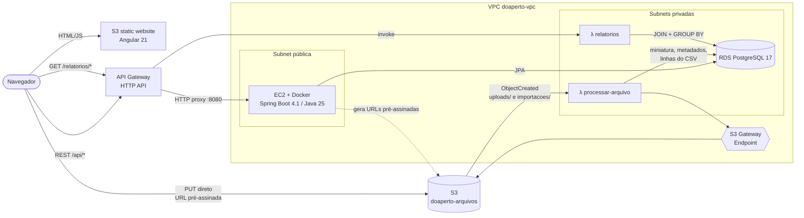
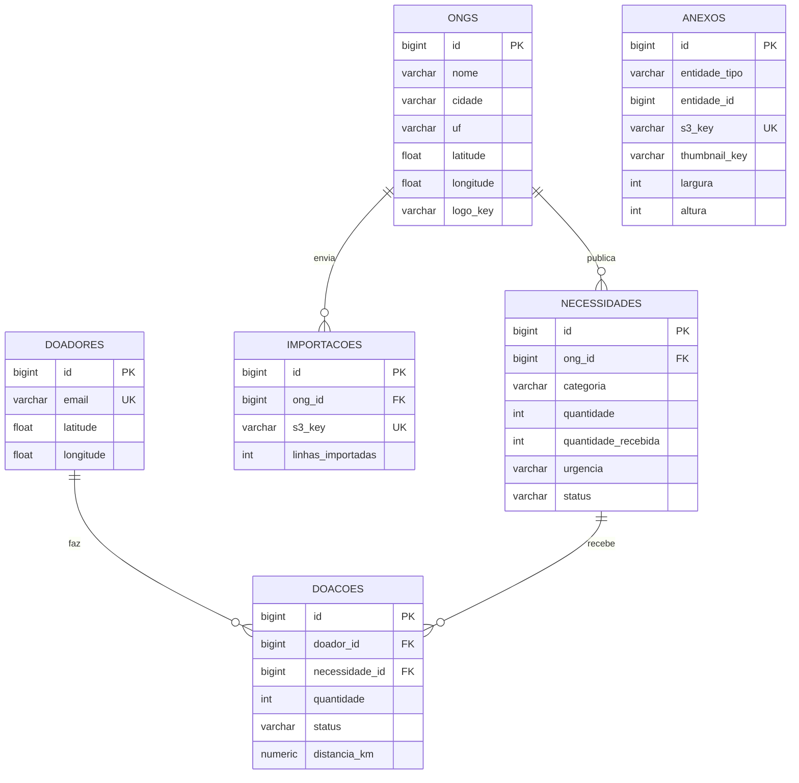

# DoaPerto — doação de alimentos e roupas, pertinho de você

> Projeto **Nuvem 1** · *Sistema de doação de alimentos e roupas*.

ONGs publicam o que precisam. O doador conta o que tem para doar. O sistema **sugere a instituição mais próxima
que precisa daquilo** — ordenando por distância (Haversine) e dando prioridade a necessidades urgentes ou longe da meta.

| Camada | Tecnologia (versões LTS) |
|---|---|
| Front-end | **Angular 21 LTS** (standalone, signals, zoneless) · Node **24 LTS** · TypeScript 5.9 |
| API CRUD | **Java 25 LTS** · **Spring Boot 4.1** · Spring Data JPA · Flyway · AWS SDK v2 |
| Funções | **AWS Lambda** Python 3.13 (Pillow + pg8000) |
| Banco | **Amazon RDS** PostgreSQL 17 em subnet privada |
| Arquivos | **Amazon S3** com URL pré-assinada |
| Borda | **API Gateway** HTTP API · S3 static website |

---

## Sumário

1. [Arquitetura](#arquitetura)
2. [Como cada requisito foi atendido](#como-cada-requisito-foi-atendido)
3. [Estrutura do repositório](#estrutura-do-repositório)
4. [Rodando localmente](#rodando-localmente)
5. [Deploy no AWS Learner Lab (passo a passo)](#deploy-no-aws-learner-lab-passo-a-passo)
6. [Nova sessão do Learner Lab (RNF-03)](#nova-sessão-do-learner-lab-rnf-03)
7. [API](#api)
8. [Bônus](#bônus)

---

## Arquitetura



**Fluxo do upload (RF-02 → RF-03):** o front pede `POST /api/anexos/upload-url` → a API registra o arquivo em `anexos`
e devolve uma URL PUT pré-assinada (10 min) → o navegador envia o arquivo **direto ao S3** → o evento `ObjectCreated`
dispara a Lambda → ela gera a miniatura (ou conta páginas do PDF, ou importa o CSV) e grava o resultado no RDS →
o front consulta a lista e mostra a miniatura.

A decisão "CRUD em container, Lambda para eventos/relatórios" está em
[`docs/adr/0001-crud-em-container-ec2.md`](docs/adr/0001-crud-em-container-ec2.md).

### Modelo de dados



---

## Como cada requisito foi atendido

| ID | Como | Onde |
|---|---|---|
| **RF-01** | CRUD completo de **ONG 1:N Necessidade** e **Doador 1:N Doação N:1 Necessidade** (doadores N:N necessidades), persistidos no RDS. Telas de listar/criar/editar/excluir para todas. | `backend/.../ong`, `necessidade`, `doador`, `doacao` · `frontend/src/app/pages` |
| **RF-02** | `POST /api/anexos/upload-url` (fotos/PDF de ONG, necessidade ou doação), `POST /api/ongs/{id}/logo/upload-url` e `POST /api/ongs/{id}/importacoes` (CSV) geram **URL PUT pré-assinada**; o navegador envia direto ao S3. | `ArmazenamentoService`, `AnexoService`, `ImportacaoController`, `upload.service.ts` |
| **RF-03** | Lambda `doaperto-processar-arquivo` (gatilho S3): **miniatura JPEG** + largura/altura de imagens, **nº de páginas** de PDFs e **importação de CSV** de necessidades (com validação linha a linha). Resultado gravado em `anexos`, `importacoes` e `necessidades`. | `lambdas/processar-arquivo` |
| **RF-04** | Lambda `doaperto-relatorios` em `GET /relatorios/{tipo}` no API Gateway: `resumo`, `necessidades-por-categoria`, `ranking-ongs`, `doacoes-por-mes`, `top-doadores` — todos com **JOIN + GROUP BY** (e CTEs/`FILTER`). | `lambdas/relatorios` · tela **Impacto** |
| **RF-05** | Angular publicado em **S3 static website**, consumindo o API Gateway. URL da API vem de `config.json` (sem rebuild). | `frontend/`, `deploy/scripts/publicar-front.sh` |
| **RNF-01** | RDS com *Public access = No* em subnets privadas; SGs por referência. | [`docs/seguranca.md`](docs/seguranca.md) |
| **RNF-02** | Senhas no **SSM Parameter Store** (EC2) e em variáveis de ambiente da Lambda; credenciais AWS via Instance Profile/LabRole; `.gitignore` bloqueia `.env`. | `deploy/ec2/iniciar-api.sh`, `.env.example` |
| **RNF-03** | Nenhum IP no código. API com `--restart unless-stopped`; front lê `config.json`; script reaponta o API Gateway ao DNS atual da EC2. | [seção abaixo](#nova-sessão-do-learner-lab-rnf-03) |
| **RNF-04** | ADR justificando container (EC2 + Docker) para o CRUD. | [`docs/adr/0001-...`](docs/adr/0001-crud-em-container-ec2.md) |
| **RNF-05** | Sem CloudFormation/Terraform/SAM. Tudo pelo console/CLI, documentado aqui. | este README |

---

## Estrutura do repositório

```
nuvem-1/
├── backend/                 API Spring Boot (Dockerfile, Flyway, testes)
│   └── src/main/resources/db/{migration,seed}
├── frontend/                Angular 21 (public/config.json = URLs em runtime)
├── lambdas/
│   ├── processar-arquivo/   gatilho S3 → miniatura / PDF / CSV → RDS
│   ├── relatorios/          API Gateway → JOIN/GROUP BY → JSON (+ servidor_local.py)
│   └── build.sh | build.ps1 gera build/*.zip com dependências Linux
├── deploy/
│   ├── ec2/                 user-data.sh e iniciar-api.sh (lê o SSM)
│   ├── s3/                  CORS do bucket de arquivos e política do site
│   └── scripts/             atualizar-integracao.sh, publicar-front.sh
├── docs/                    ADR, segurança/SGs, CSV de exemplo
├── docker-compose.yml       Postgres + API para desenvolvimento
└── .github/workflows/ci.yml CI (bônus)
```

---

## Rodando localmente

Pré-requisitos: **JDK 25**, **Node 24**, **Python 3.13+** e Docker (opcional).

```bash
cp .env.example .env          # defina DB_PASSWORD
docker compose --env-file .env up --build      # Postgres + API em http://localhost:8080
```

Sem Docker: suba um PostgreSQL qualquer e rode a API com as variáveis `DB_URL`, `DB_USERNAME`, `DB_PASSWORD`:

```bash
cd backend && ./mvnw spring-boot:run
```

Front-end (usa `public/config.json` → `http://localhost:8080`):

```bash
cd frontend && npm ci && npm start             # http://localhost:4200
```

Relatórios (a mesma Lambda, servida por um HTTP local na porta 3001):

```bash
cd lambdas/relatorios && pip install -r requirements.txt
DB_HOST=localhost DB_USER=doaperto DB_PASSWORD=... DB_SSL=false python servidor_local.py
```

> Uploads locais funcionam se `S3_BUCKET` estiver definido e houver credenciais em `~/.aws/credentials`
> (copie de **AWS Details** no Learner Lab). Sem isso, o resto do sistema funciona normalmente.

Testes:

```bash
cd backend && ./mvnw test                      # integração (H2) + ranking do match
cd frontend && npx ng test --watch=false       # Vitest
```

O Flyway cria o esquema e carrega **dados de exemplo** (10 ONGs, 24 necessidades, 16 doações).
Para não carregar: `FLYWAY_LOCATIONS=classpath:db/migration` no primeiro start.

---

## Deploy no AWS Learner Lab (passo a passo)

Região: **us-east-1**. Onde aparecer `<id>`, use um sufixo seu (ex.: matrícula), pois nomes de bucket são globais.
Os comandos CLI podem ser rodados no **CloudShell**.

### 1. Rede (VPC)

**VPC → Create VPC → VPC and more**: nome `doaperto`, 2 AZs, **2 subnets públicas, 2 privadas**,
**NAT gateways: None**, **VPC endpoints: S3 Gateway**. Crie os três Security Groups descritos em
[`docs/seguranca.md`](docs/seguranca.md): `sg-api`, `sg-lambda`, `sg-rds`.

### 2. Banco (RDS PostgreSQL)

1. **RDS → Subnet groups → Create**: `doaperto-db-subnets` com **as duas subnets privadas**.
2. **Create database**: Standard create · PostgreSQL 17 · template *Free tier/Dev* · `db.t3.micro` · 20 GB gp3.
   - DB identifier `doaperto-db`, master user `doaperto_admin`, senha forte (guarde para o passo 3).
   - VPC `doaperto-vpc`, subnet group `doaperto-db-subnets`, **Public access: No**, SG **`sg-rds`**.
   - *Additional configuration* → **Initial database name: `doaperto`**. Desligue Performance Insights e Enhanced Monitoring.
3. Anote o **endpoint** (ex.: `doaperto-db.xxxx.us-east-1.rds.amazonaws.com`).

### 3. Segredos no Parameter Store (bônus)

```bash
aws ssm put-parameter --name /doaperto/db/url      --type String       --value "jdbc:postgresql://<ENDPOINT_RDS>:5432/doaperto"
aws ssm put-parameter --name /doaperto/db/username --type String       --value "doaperto_admin"
aws ssm put-parameter --name /doaperto/db/password --type SecureString --value "<SENHA>"
aws ssm put-parameter --name /doaperto/s3/bucket   --type String       --value "doaperto-arquivos-<id>"
```

### 4. Bucket de arquivos (privado)

```bash
aws s3api create-bucket --bucket doaperto-arquivos-<id>
aws s3api put-bucket-cors --bucket doaperto-arquivos-<id> --cors-configuration "{\"CORSRules\": $(cat deploy/s3/cors-arquivos.json)}"
```

Mantenha o **Block Public Access ligado**.

### 5. API na EC2 (container)

1. **EC2 → Launch instance**: nome `doaperto-api`, **Amazon Linux 2023**, `t3.small`, key pair opcional.
2. Network: `doaperto-vpc`, **subnet pública**, *Auto-assign public IP: Enable*, SG **`sg-api`**.
3. *Advanced details* → **IAM instance profile: `LabInstanceProfile`** → **User data**: cole
   [`deploy/ec2/user-data.sh`](deploy/ec2/user-data.sh) com a URL do seu repositório.
4. Após ~3 min: `curl http://<DNS_PUBLICO>:8080/actuator/health` → `{"status":"UP"}`.
   (O Flyway cria as tabelas no primeiro start.)
5. *(Recomendado)* **Elastic IP → Allocate → Associate** à instância: o DNS deixa de mudar entre sessões.

Para atualizar o código depois: `sudo bash /opt/doaperto/deploy/ec2/iniciar-api.sh --pull`.

### 6. Lambdas

Gere os pacotes (na sua máquina):

```bash
bash lambdas/build.sh            # ou: powershell -File lambdas/build.ps1
```

Para **cada** função — **Lambda → Create function → Author from scratch**:

| | `doaperto-processar-arquivo` | `doaperto-relatorios` |
|---|---|---|
| Runtime / arquitetura | Python 3.13 / x86_64 | Python 3.13 / x86_64 |
| Execution role | *Use an existing role* → **LabRole** | **LabRole** |
| Código | *Upload from .zip* → `lambdas/build/processar-arquivo.zip` | `lambdas/build/relatorios.zip` |
| Configuration → General | Memória 512 MB · Timeout 1 min | 256 MB · 15 s |
| Configuration → VPC | `doaperto-vpc`, **subnets privadas**, SG **`sg-lambda`** | idem |
| Environment variables | `DB_HOST`=endpoint RDS · `DB_NAME`=doaperto · `DB_USER` · `DB_PASSWORD` | as mesmas |

Gatilho do S3 (**só em `doaperto-processar-arquivo`**): *Add trigger → S3* → bucket `doaperto-arquivos-<id>`,
evento *All object create events*, **Prefix `uploads/`**. Repita com **Prefix `importacoes/`**.

> ⚠️ Não crie o gatilho sem prefixo: a Lambda grava miniaturas em `thumbnails/` e entraria em loop.

### 7. API Gateway (HTTP API)

**API Gateway → Create API → HTTP API → Build**, nome **`doaperto-api`**:

1. *Integrations*:
   - **HTTP** · método `ANY` · URL `http://<DNS_PUBLICO_EC2>:8080/api/{proxy}`
   - **Lambda** · `doaperto-relatorios`
2. *Routes*:
   - `ANY /api/{proxy+}` → integração HTTP
   - `GET /relatorios` e `GET /relatorios/{tipo}` → Lambda
3. Stage `$default` com *auto-deploy*.
4. **CORS**: Allow origin `*` (ou a URL do site) · methods `GET,POST,PUT,PATCH,DELETE,OPTIONS` · headers `content-type`.

Teste: `curl https://<api-id>.execute-api.us-east-1.amazonaws.com/api/ongs` e `.../relatorios/resumo`.

### 8. Front-end (S3 static website)

1. Crie o bucket `doaperto-site-<id>`, **desligue o Block Public Access**, aplique
   [`deploy/s3/politica-site.json`](deploy/s3/politica-site.json) (troque o nome do bucket).
2. *Properties → Static website hosting*: index `index.html`, **error `index.html`** (rotas do Angular).
3. Publique:

```bash
SITE_BUCKET=doaperto-site-<id> API_URL=https://<api-id>.execute-api.us-east-1.amazonaws.com bash deploy/scripts/publicar-front.sh
```

Acesse `http://doaperto-site-<id>.s3-website-us-east-1.amazonaws.com` 🎉

---

## Nova sessão do Learner Lab (RNF-03)

1. **Start Lab** e espere o indicador ficar verde.
2. Confira se a EC2 `doaperto-api` e o RDS `doaperto-db` estão *running/available* (inicie-os se estiverem parados).
   A API volta sozinha: o Docker está habilitado no boot e o container tem `--restart unless-stopped`
   (se ela subir antes do RDS, reinicia até conectar).
3. **Sem Elastic IP?** O DNS público da EC2 mudou. No CloudShell:
   ```bash
   bash deploy/scripts/atualizar-integracao.sh
   ```
4. Abra o site. O `config.json` aponta para o API Gateway, cuja URL não muda entre sessões.

Nada disso exige alterar código: endereços vivem no API Gateway, no Parameter Store e no `config.json` do bucket.

---

## API

Base: `https://<api-id>.execute-api.us-east-1.amazonaws.com` (ou `http://localhost:8080`). Erros seguem RFC 9457 (`application/problem+json`).

| Método | Rota | Descrição |
|---|---|---|
| GET/POST | `/api/ongs` | Lista (`?termo=&uf=`) / cria |
| GET/PUT/DELETE | `/api/ongs/{id}` | Detalhe / atualiza / exclui (cascata) |
| POST | `/api/ongs/{id}/logo/upload-url` | URL pré-assinada para o logo |
| GET/POST | `/api/ongs/{id}/importacoes` | Histórico / URL pré-assinada para CSV |
| GET | `/api/importacoes/{id}` | Status de uma importação |
| GET/POST | `/api/necessidades` | Lista (`?ongId=&categoria=&urgencia=&status=&uf=&termo=`) / cria |
| GET/PUT/DELETE | `/api/necessidades/{id}` | |
| GET/POST | `/api/doadores` | Lista (`?termo=` ou `?email=`) / cria |
| GET/PUT/DELETE | `/api/doadores/{id}` | |
| GET/POST | `/api/doacoes` | Lista (`?doadorId=&ongId=&status=`) / cria (calcula a distância) |
| PATCH | `/api/doacoes/{id}/status` | `PENDENTE → CONFIRMADA → ENTREGUE` (entrega soma na necessidade) ou `CANCELADA` |
| GET | `/api/sugestoes?categoria=&lat=&lng=&limite=` | **Match**: ONGs mais indicadas |
| POST | `/api/anexos/upload-url` | URL pré-assinada (JPG/PNG/WEBP/GIF/PDF ≤ 10 MB) |
| GET | `/api/anexos?entidadeTipo=&entidadeId=` | Arquivos com URLs GET temporárias e miniaturas |
| DELETE | `/api/anexos/{id}` | Remove do S3 e do banco |
| GET | `/relatorios` · `/relatorios/{tipo}?uf=` | Lambda de relatórios |
| GET | `/actuator/health` | Health check |

### O algoritmo de match

```
distância   = haversine(doador, ONG)
ajustada    = distância / (pesoUrgência × (1 + 0,25 × fraçãoQueFalta))
pesoUrgência: alta 1,8 · média 1,35 · baixa 1,0
```

A ONG mais próxima vence, mas uma necessidade urgente e longe da meta "puxa" a instituição para cima.
Veja `SugestaoService` e o teste `SugestaoServiceTest`.

### CSV de necessidades

Separador `,` ou `;`, UTF-8 ou Windows-1252 (Excel). Colunas: `titulo`, `categoria`, `quantidade`
(obrigatórias), `unidade`, `urgencia`, `descricao`. Exemplo em
[`docs/exemplos/necessidades-exemplo.csv`](docs/exemplos/necessidades-exemplo.csv) (a última linha tem erro proposital
para demonstrar a validação). A tela da ONG também oferece o modelo para download.

---

## Bônus

- ✅ **Parameter Store**: credenciais do banco para a EC2 (`/doaperto/*`, SecureString).
- ✅ **CI com GitHub Actions**: `.github/workflows/ci.yml` compila e testa backend, front e Lambdas e guarda os artefatos.
  Deploy automático não está ligado porque as credenciais do Learner Lab expiram; para habilitar o do front, crie os
  secrets `AWS_ACCESS_KEY_ID`, `AWS_SECRET_ACCESS_KEY`, `AWS_SESSION_TOKEN` a cada sessão e chame `publicar-front.sh`.
- ➕ **Alarmes no CloudWatch** (sugestão para a apresentação): *CloudWatch → Alarms → Create* → métrica
  `AWS/Lambda › Errors` da função `doaperto-processar-arquivo`, `Sum ≥ 1` em 5 min. Repita para `doaperto-relatorios`.
- ➕ **CloudFront** na frente do bucket do site dá HTTPS e cache; aponte o *error response* 403/404 para `/index.html`.
