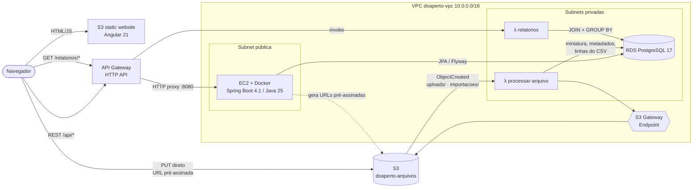
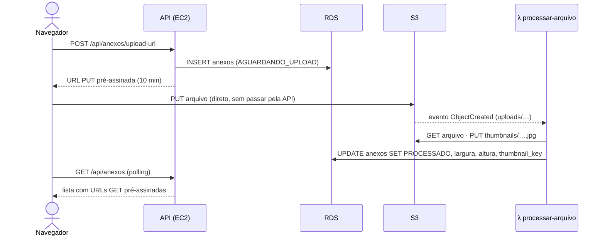
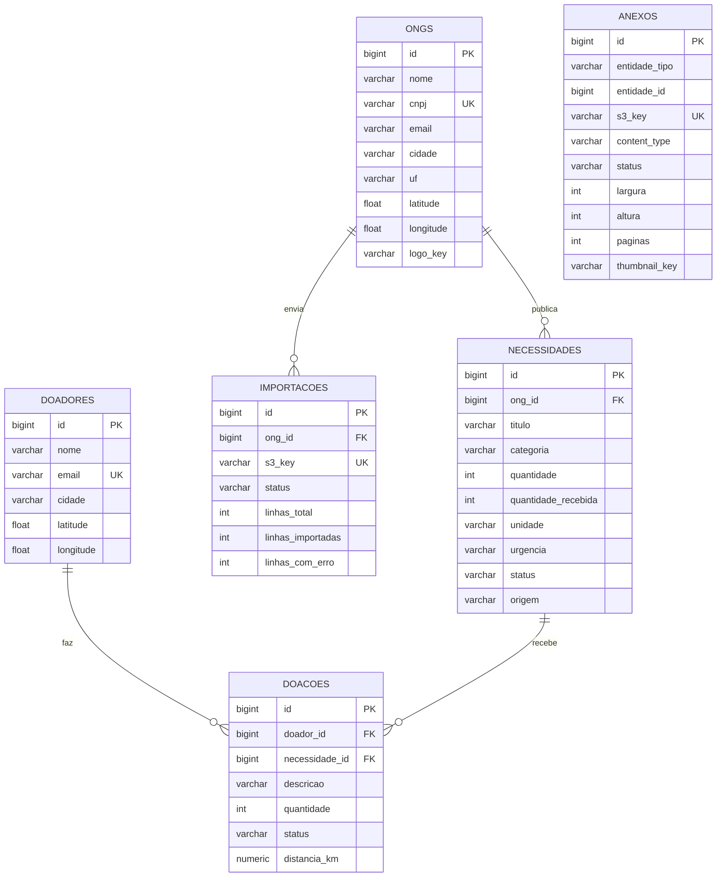

# design.md — DoaPerto

> Arquitetura, modelo de dados e rotas. Diagramas modelados com apoio de IA (ver `ia-log.md`) e revisados pela equipe.
> Decisão CRUD em container × Lambda: [ADR 0001](docs/adr/0001-crud-em-container-ec2.md).

## 1. Arquitetura



| Componente | Serviço AWS | Responsabilidade |
|---|---|---|
| Front-end | S3 static website | SPA Angular 21; lê as URLs da API de `config.json` |
| Borda | API Gateway (HTTP API) | `ANY /api/{proxy+}` → EC2 · `GET /relatorios/{tipo}` → Lambda · CORS |
| API CRUD | EC2 t3.small + Docker | Spring Boot 4.1 (Java 25): CRUD, match, URLs pré-assinadas |
| Banco | RDS PostgreSQL 17 (privado) | Dados relacionais; schema versionado com Flyway |
| Arquivos | S3 privado | Fotos, logos, PDFs, CSVs e miniaturas |
| Processamento | Lambda Python 3.13 | Miniatura (Pillow), páginas de PDF, importação de CSV |
| Relatórios | Lambda Python 3.13 | Consultas analíticas com JOIN/GROUP BY |
| Segredos | SSM Parameter Store | URL, usuário e senha do banco para a EC2 |

### Fluxo de upload (RF-02 → RF-03)



### Rede

Detalhes de VPC, subnets e Security Groups em [`docs/seguranca.md`](docs/seguranca.md).

| SG | Entrada | Usado por |
|---|---|---|
| `sg-api` | 8080 de 0.0.0.0/0 (API Gateway) · 22 só do seu IP (opcional) | EC2 |
| `sg-lambda` | nenhuma | Lambdas |
| `sg-rds` | 5432 de `sg-api` e `sg-lambda` | RDS |

## 2. Modelo de dados (ER)



- **Relacionamentos do RF-01:** ONG 1:N Necessidade; Doador 1:N Doação; Necessidade 1:N Doação (Doador N:N Necessidade via Doação).
- **Domínios (CHECK):** categoria ∈ {ALIMENTO, ROUPA, CALCADO, HIGIENE, COBERTOR, BRINQUEDO, OUTRO}; urgência ∈ {BAIXA, MEDIA, ALTA};
  status da necessidade ∈ {ABERTA, ATENDIDA, CANCELADA}; status da doação ∈ {PENDENTE, CONFIRMADA, ENTREGUE, CANCELADA}.
- **Scripts versionados:** `backend/src/main/resources/db/migration/V1__schema.sql` (schema) e
  `db/seed/V2__dados_exemplo.sql` (dados de demonstração), aplicados pelo Flyway no start da API.

## 3. Rotas da API

Base: `https://<api-id>.execute-api.us-east-1.amazonaws.com`. Erros em `application/problem+json` (RFC 9457).

| Método | Rota | Descrição | RF |
|---|---|---|---|
| GET | `/api/ongs?termo=&uf=` | Lista ONGs | RF-01 |
| POST | `/api/ongs` | Cria ONG | RF-01 |
| GET · PUT · DELETE | `/api/ongs/{id}` | Detalha · atualiza · exclui (cascata) | RF-01 |
| GET | `/api/necessidades?ongId=&categoria=&urgencia=&status=&uf=&termo=` | Lista necessidades | RF-01 |
| POST | `/api/necessidades` | Cria necessidade | RF-01 |
| GET · PUT · DELETE | `/api/necessidades/{id}` | | RF-01 |
| GET | `/api/doadores?termo=` · `?email=` | Lista / busca por e-mail | RF-01 |
| POST | `/api/doadores` | Cria doador | RF-01 |
| GET · PUT · DELETE | `/api/doadores/{id}` | | RF-01 |
| GET | `/api/doacoes?doadorId=&ongId=&necessidadeId=&status=` | Lista doações | RF-01 |
| POST | `/api/doacoes` | Cria doação (calcula distância) | RF-01 |
| PUT · DELETE | `/api/doacoes/{id}` | Edita · exclui (estorna se entregue) | RF-01 |
| PATCH | `/api/doacoes/{id}/status` | Muda status (regras de transição) | RF-01 |
| GET | `/api/sugestoes?categoria=&lat=&lng=&termo=&limite=` | **Match** doador → ONG | — |
| POST | `/api/anexos/upload-url` | URL PUT pré-assinada (foto/PDF) | RF-02 |
| POST | `/api/ongs/{id}/logo/upload-url` | URL PUT pré-assinada do logo | RF-02 |
| GET | `/api/anexos?entidadeTipo=&entidadeId=` | Arquivos + miniaturas (URLs GET temporárias) | RF-02/03 |
| DELETE | `/api/anexos/{id}` | Remove do S3 e do banco | RF-02 |
| POST | `/api/ongs/{id}/importacoes` | URL PUT pré-assinada do CSV | RF-02 |
| GET | `/api/ongs/{id}/importacoes` · `/api/importacoes/{id}` | Status da importação | RF-03 |
| GET | `/relatorios` | Lista relatórios (Lambda) | RF-04 |
| GET | `/relatorios/{tipo}?uf=` | `resumo`, `necessidades-por-categoria`, `ranking-ongs`, `doacoes-por-mes`, `top-doadores` | RF-04 |
| GET | `/actuator/health` | Health check | — |

## 4. Algoritmo de match

```
distância    = haversine(doador, ONG)
ajustada     = distância / (pesoUrgência × (1 + 0,25 × fraçãoQueFalta))
pesoUrgência = alta 1,8 · média 1,35 · baixa 1,0
```

Ordena por `ajustada`: a mais próxima vence, mas urgência alta e meta distante puxam a ONG para cima.
Implementação: `SugestaoService`; teste: `SugestaoServiceTest`.
